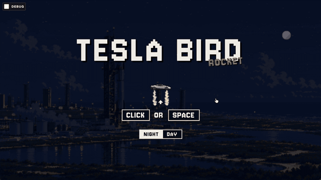
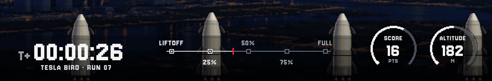

# Tesla Bird

A Flappy-Bird-style pixel-art game: fly the Roadster through gaps between
Starship rocket pillars. Built with vanilla JavaScript and a single `<canvas>`,
with no runtime dependencies and no framework. It grew out of my
[vanilla Flappy Bird on CodePen][codepen-original].

The idea comes from the new Tesla Roadster's thruster-powered flight at its
[unveiling on October 16, 2026][roadster-cnbc]. In the game, every boost fires
smoke from the wheels, and the car tilts as it climbs and falls.

<p align="center">
  <a href="https://troshkinpavel.github.io/tesla-bird/"><strong>▶ Play in your browser</strong></a>
</p>

<p align="center">
  
</p>

## Play

Play online at <https://troshkinpavel.github.io/tesla-bird/> in a desktop
browser.

To play offline, open `index.html` from a copy of this repository. No build step
is needed: the built files are committed. See [Run locally](#run-locally) to
serve it over HTTP or to change the code.

## Controls

| Action | Mouse | Keyboard |
| --- | --- | --- |
| Start, then boost | Left click | Space, Arrow Up or W |
| Restart after a crash | Click the play button | Space |
| Switch theme | NIGHT / DAWN / DAY on the start screen | Tab to the switch, then Enter |

The first click or Space on the start screen starts the run and counts as the
first boost.

## How to play

- Gravity pulls the car down. Each boost sends it up again.
- Pass between the rocket pillars. Each pair you pass scores 1 point.
- The run ends if the car touches a pillar's hull, the top of the screen or the
  bottom of the screen. The fins on the noses and engines are decoration, so
  they do not count as a hit.

**Charge** replaces the medals of the original game:

| Score | Charge |
| ---: | ---: |
| 0–9 | 0% |
| 10–19 | 25% |
| 20–29 | 50% |
| 30–39 | 75% |
| 40+ | 100% (FULL) |

## Telemetry

During a run, a telemetry strip along the bottom of the screen shows the state
of the flight.



| Item | Shows |
| --- | --- |
| Mission clock | Time alive in the current run, as `T+HH:MM:SS`. |
| Run counter | `TESLA BIRD · RUN NN`. It counts every run you start. |
| Progress timeline | Nodes for LIFTOFF, 25%, 50%, 75% and FULL (scores 0, 10, 20, 30 and 40). The red tick marks your current score. |
| SCORE gauge | Points in this run. The arc fills as you get closer to the next charge level. |
| ALTITUDE gauge | Height of the car above the bottom of the screen, in metres (1 game pixel = 1 m). |

The game-over screen shows three gauges (CHARGE, SCORE and BEST), the full
timeline with a red CRASH marker at your score, and the final mission clock.

## Themes

| Theme | Background | How to get it |
| --- | --- | --- |
| `night` | Starbase at night | NIGHT on the start screen |
| `dawn` | Starbase at dawn | DAWN on the start screen |
| `day` | Starbase in daylight | DAY on the start screen |

When you first open the game, it uses your browser's light or dark setting
(light gives `day`, dark gives `night`). When you select an option on the switch, the game
remembers that choice. A `?theme=` value in the URL overrides both.

To add a theme, add an entry (background image, dim colour, dim opacity) to
`THEMES` in [`config.js`](flappy-assets/script/config.js).

## Screen sizes

The game uses a resolution of 640×360 game pixels. It draws them at 3×
(1920×1080) with nearest-neighbour scaling, so the pixel art stays sharp. If
the window is not 16:9, the playfield grows to fill it, so there are no black
bars:

- A taller window shows more sky above and below the gaps.
- A wider window shows more pillars at the same time.

The game is made for desktop browsers. It does not support touch input.

## Run locally

You need [Node.js](https://nodejs.org/) 18 or later for the tests and the build.
The game does not need Node.js to run.

```sh
python3 -m http.server 4173
```

Then open <http://localhost:4173/>. Any static file server works.

| Command | What it does |
| --- | --- |
| `npm test` | Runs the unit tests with the built-in `node --test` runner. |
| `npm run build` | Bundles the scripts and the stylesheet into content-hashed files and updates the references in `index.html`. |
| `npm run check` | Runs the tests, then the build. |

If you change a file in `flappy-assets/script/` or `flappy-assets/style/`, run
`npm run build`. `index.html` loads the built files, not the source files.

### URL parameters

| Parameter | Effect |
| --- | --- |
| `?theme=night`, `dawn` or `day` | Uses this theme and ignores the saved choice. |
| `?debug=true` | Shows the hitboxes. If the car hits a pillar, the run continues, but that pillar does not score. The best score is not saved. The top and bottom of the screen still end the run. The **Debug** checkbox in the top-left corner sets this parameter. |

## Configuration

[`app.js`](flappy-assets/script/app.js) starts the game:

```js
FlappyBird('container', {
    difficulty: 'normal', // easy | normal | hard
    theme: 'day'          // optional; leave it out to use the saved or browser choice
});
```

### Difficulty

All values are in game pixels.

| Level | Pillar spacing | Gap height | Largest change in gap position |
| --- | ---: | ---: | ---: |
| `easy` | 200 | 96 | 50 |
| `normal` | 170 | 80 | 60 |
| `hard` | 145 | 70 | 72 |

Physics and the other tuning values (speed, gravity, boost strength, hitbox)
are in `DEFAULT_SETTINGS` in [`config.js`](flappy-assets/script/config.js).

## Project structure

```text
index.html                     Page; loads the built bundle
flappy-assets/
  script/
    app.js                     Entry point: reads URL parameters, starts the game
    flappy.js                  Game loop, canvas rendering, HUD, menus, input
    config.js                  Themes, difficulty levels, option checks
    physics.js                 Movement, collisions, charge and clock helpers
    storage.js                 localStorage helpers
    app.<hash>.js              Built bundle (created by npm run build)
  style/
    styles.css                 Source stylesheet
    styles.<hash>.css          Built stylesheet
  image/                       Sprites and theme backgrounds
docs/                          README images
scripts/build.mjs              Build script for the hashed files
test/                          Unit tests (node --test)
```

## Saved data

The best score, the run counter and the last chosen theme are kept in the
browser's `localStorage` (`tesla-bird-best-score`, `tesla-bird-runs`,
`tesla-bird-theme`).

## Browser support

Use a recent desktop version of Chrome, Edge, Firefox or Safari.

The UI font, [Jersey 10][jersey-10], loads from Google Fonts. When you are
offline, the text uses a monospace font.

## References

- [Flappy Bird][flappy-bird]: the 2013 mobile game by Dong Nguyen. This game
  copies its controls and its scoring.
- [Vanilla Flappy Bird on CodePen][codepen-original]: my earlier version of the
  game, which this project is based on.
- [Tesla unveils its next-generation Roadster 'flying car'][roadster-cnbc]:
  CNBC, October 16, 2026. This event is the source of the flying car.
- [Starship][starship]: SpaceX. The rocket pillars use its nose, body and
  engine sections.
- [Jersey 10][jersey-10]: Google Fonts, licensed under the SIL Open Font
  License 1.1.
- [Dinkie Icons][dinkie-icons] by atelierAnchor: the GitHub and X icons on the
  start screen ([license][dinkie-icons-license]).

## Disclaimer

This is a fan project. It is not affiliated with, endorsed by or sponsored by
Tesla, Inc. or Space Exploration Technologies Corp. "Tesla", "Roadster",
"SpaceX" and "Starship" are trademarks of their owners.

[roadster-cnbc]: https://www.cnbc.com/video/2026/10/16/tesla-unveils-its-next-generation-roadster-flying-car.html
[codepen-original]: https://codepen.io/Maseone/pen/vYBdGP
[flappy-bird]: https://en.wikipedia.org/wiki/Flappy_Bird
[starship]: https://www.spacex.com/vehicles/starship/
[jersey-10]: https://fonts.google.com/specimen/Jersey+10
[dinkie-icons]: https://github.com/atelier-anchor/dinkie-icons
[dinkie-icons-license]: https://github.com/atelier-anchor/dinkie-icons/blob/main/LICENSE
